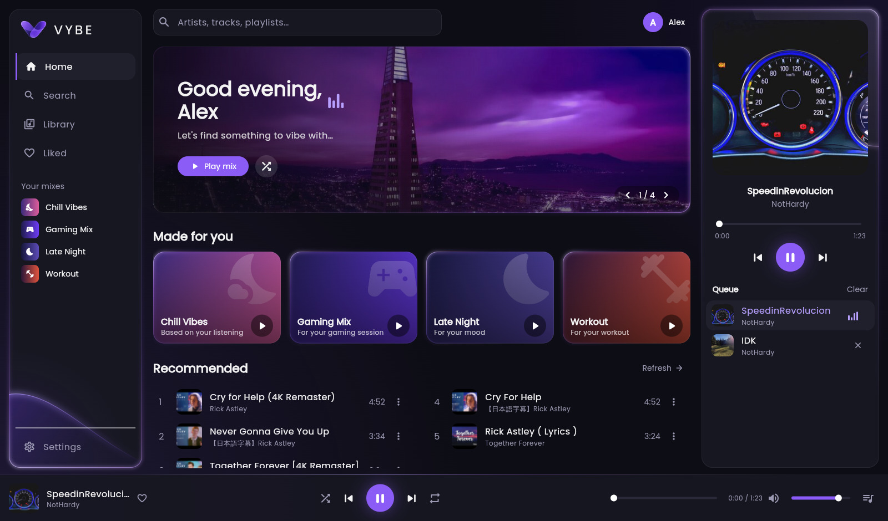

<p align="center">
  
</p>

<p align="center">
  <a href="https://github.com/sawilove/vybe/releases/latest"></a>
  <a href="https://github.com/sawilove/vybe/actions/workflows/ci.yml"></a>
  
  <a href="LICENSE"></a>
</p>

<p align="center">
  <b>VYBE</b> is a lightweight, open-source music streaming client.<br>
  Type a song name and VYBE finds it across every source at once, like a Telegram music bot,<br>
  then keeps the music going with recommendations computed right on your device.
</p>

<p align="center">
  
</p>

## Features

<table>
  <tr>
    <td width="64"></td>
    <td><b>One search for everything</b><br>YouTube, Yandex Music, VK, SoundCloud, Audius and your own files in a single search box.</td>
    <td width="64"></td>
    <td><b>Made for you</b><br>Recommendations and mood mixes built from your history and likes, on the device. Optional Last.fm.</td>
  </tr>
  <tr>
    <td></td>
    <td><b>Auto radio</b><br>When the queue ends, VYBE keeps playing similar tracks.</td>
    <td></td>
    <td><b>Offline</b><br>Download any track. Liked tracks are saved for offline listening automatically.</td>
  </tr>
  <tr>
    <td></td>
    <td><b>A real player</b><br>Queue, shuffle, repeat, background playback and lock screen controls, keyboard shortcuts.</td>
    <td></td>
    <td><b>Every platform</b><br>Android, iOS, Windows, macOS and Linux from one codebase, with layouts for desktop and phone.</td>
  </tr>
  <tr>
    <td></td>
    <td><b>English & Russian</b><br>Follows your system language, or pick one in Settings.</td>
    <td></td>
    <td><b>Private by design</b><br>No accounts, no VYBE server. History, likes and tokens never leave your device.</td>
  </tr>
</table>

## Download

<table>
  <tr>
    <td width="64"></td>
    <td>
      Get the latest build for your platform from <a href="https://github.com/sawilove/vybe/releases/latest"><b>Releases</b></a>:
      Android <code>.apk</code>, Windows <code>.zip</code>, macOS <code>.zip</code>, Linux <code>.tar.gz</code>
      and an unsigned iOS <code>.ipa</code> for sideloading (AltStore / SideStore).
    </td>
  </tr>
</table>

- **macOS:** the app isn't notarized; right-click → *Open* the first time.
- **Linux:** needs `libmpv` (`sudo apt install libmpv2` or your distro's equivalent).

## Music sources

| Source | Setup |
| --- | --- |
| YouTube / YT Music | Works out of the box |
| Audius | Works out of the box |
| Yandex Music | Search works where the service is available; playback needs your token |
| VK | Your own audio token |
| SoundCloud | A client ID |
| Your files | Library → My files |

How to connect each one: **[docs/SOURCES.md](docs/SOURCES.md)**. VYBE never asks for passwords and
never ships anyone's keys.

> [!NOTE]
> YouTube, VK and Yandex Music are used through unofficial APIs. This goes against their terms,
> which is why VYBE is distributed only through GitHub Releases. See
> [docs/ARCHITECTURE.md](docs/ARCHITECTURE.md#about-youtube-vk-and-yandex-music).

## Build from source

<table>
  <tr>
    <td width="64"></td>
    <td>Requires <a href="https://docs.flutter.dev/get-started/install">Flutter 3.50+</a>.
    On Linux also <code>sudo apt install clang cmake ninja-build pkg-config libgtk-3-dev libmpv-dev</code>.</td>
  </tr>
</table>

```bash
git clone https://github.com/sawilove/vybe.git && cd vybe
flutter pub get
flutter run          # on a connected device or your desktop
flutter test
```

## Documentation

- [Architecture](docs/ARCHITECTURE.md): layers, sources, player, offline cache, recommendations, design system
- [Music sources](docs/SOURCES.md)
- [Roadmap](docs/ROADMAP.md)
- [Changelog](CHANGELOG.md) · [Releasing](docs/RELEASING.md) · [Contributing](CONTRIBUTING.md)
- Banner photos are CC0: [credits](assets/banners/CREDITS.md)

## License

[MIT](LICENSE)
